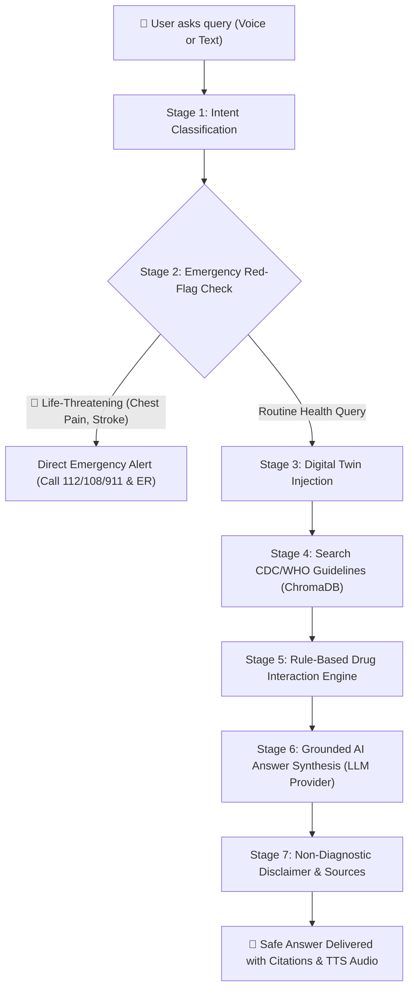

# 🩺 MedTwin AI: Clinical Digital Twin & Conversational Health Assistant

[](https://www.python.org/)
[](https://fastapi.tiangolo.com/)
[](https://streamlit.io/)
[](https://www.postgresql.org/)
[](https://www.sqlite.org/)
[](https://www.trychroma.com/)
[](LICENSE)

> **"What if your AI medical assistant actually remembered your health background and actively protected you from dangerous drug interactions?"**

**MedTwin AI** is an intelligent, edge-first clinical knowledge assistant. It combines **authoritative medical guidelines** (from the CDC, WHO, and NIH) with a personalized **Patient Digital Twin** to deliver safe, educational answers to your health and medication questions—via text or voice.

---

## 📖 Table of Contents
1. [🌟 What is MedTwin AI? (In Plain English)](#-what-is-medtwin-ai-in-plain-english)
2. [💡 The Problem It Solves](#-the-problem-it-solves)
3. [🧠 How Does It Work? The 3 Core Pillars](#-how-does-it-work-the-3-core-pillars)
4. [🤖 Pluggable LLM Provider Layer (Ollama & Hugging Face)](#-pluggable-llm-provider-layer-ollama--hugging-face)
5. [🔄 The 7-Stage Chain of Thought (CoT) Engine](#-the-7-stage-chain-of-thought-cot-engine)
6. [🗄️ Database Architecture (SQLite & PostgreSQL)](#️-database-architecture-sqlite--postgresql)
7. [🎙️ Voice Dictation (Whisper Speech-to-Text)](#️-voice-dictation-whisper-speech-to-text)
8. [⚡ Two-Layer Fast Caching (0ms Repetitive Queries)](#-two-layer-fast-caching-0ms-repetitive-queries)
9. [🎬 2-Minute Interactive Demo Script](#-2-minute-interactive-demo-script)
10. [🚀 Step-by-Step Installation & Setup](#-step-by-step-installation--setup)
11. [☁️ Deploying on Streamlit Cloud](#️-deploying-on-streamlit-cloud)
12. [💻 How to Run the Project Locally](#-how-to-run-the-project-locally)
13. [🧪 Automated Testing & Coverage](#-automated-testing--coverage)
14. [⚠️ Safety & Ethical Boundaries](#️-safety--ethical-boundaries)

---

## 🌟 What is MedTwin AI? (In Plain English)

Imagine you visit a doctor or pharmacist. Before they advise you on taking a medicine, they always ask:
- *"Are you allergic to anything?"*
- *"Do you have conditions like high blood pressure, diabetes, or asthma?"*
- *"What other pills are you currently taking?"*

Standard AI chatbots **do not remember this**. If you ask them *"Can I take Ibuprofen for a headache?"*, they will casually reply *"Yes, Ibuprofen is an OTC NSAID that helps headaches."*

**However, if you take blood pressure medicine (like Lisinopril) or diabetes medication (like Metformin), Ibuprofen can trigger acute kidney injury (AKI) and dangerous blood pressure spikes!**

**MedTwin AI fixes this:**
1. You maintain your **Digital Twin** (your virtual health profile: allergies, conditions, and active prescriptions).
2. It stores your profile securely in your **own local database** (SQLite or PostgreSQL).
3. Whenever you ask a question, it automatically cross-checks your unique health profile and official medical guidelines to ensure the advice is **strictly safe for you**.

---

## 💡 The Problem It Solves

| Ordinary AI Chatbots | 🩺 MedTwin AI |
| :--- | :--- |
| ❌ Has no memory of your medical history | ✅ Remembers your allergies, medications & conditions |
| ❌ Can hallucinate or invent medical treatments | ✅ Grounded strictly in CDC, NIH, ADA, and WHO clinical guides |
| ❌ Might miss dangerous drug conflicts | ✅ Hardcoded Drug Interaction Safety Engine blocks dangerous combos |
| ❌ Gives slow answers every time | ✅ Two-layer smart cache answers identical questions in **0ms** |
| ❌ Dependent on a single cloud service | ✅ Pluggable LLM Provider (Ollama locally or Hugging Face in cloud) |
| ❌ Might give false hope during heart attacks | ✅ Instantly detects emergencies and directs you to 112 / 108 / 911 & the ER |

---

## 🧠 How Does It Work? The 3 Core Pillars

### 1. The Patient Digital Twin (Your Health Memory)
A "Digital Twin" is simply a digital version of your medical background:
* **Demographics**: Name, Age, Gender
* **Allergies**: Penicillin, Peanuts, Sulfa, Aspirin, Ibuprofen, etc.
* **Chronic Conditions**: Type 2 Diabetes, Hypertension, Asthma, etc.
* **Current Medications**: Lisinopril, Metformin, etc.
* **Lifestyle Notes**: Diet, exercise habits, smoking status

### 2. RAG Knowledge Base (Retrieval-Augmented Generation)
Instead of relying on guesswork, MedTwin AI searches a local vector database (**ChromaDB**) holding authoritative clinical guidelines from:
* 🏛️ **CDC** (Centers for Disease Control and Prevention)
* 🏛️ **NIH / MedlinePlus** (National Institutes of Health)
* 🏛️ **WHO** (World Health Organization)
* 🏛️ **ADA** (American Diabetes Association)

### 3. Deterministic Clinical Safety Engine
AI models can sometimes be unpredictable. MedTwin AI uses **hardcoded clinical rules** that run *before* and *after* AI generation:
* **Ibuprofen + Lisinopril**: Warns of Acute Kidney Injury (AKI) and blood pressure spikes.
* **Ibuprofen + Metformin**: Warns of impaired renal drug clearance and lactic acidosis.
* **Ibuprofen + Asthma**: Warns of severe bronchospasms (Aspirin-Exacerbated Respiratory Disease).
* **Chest Pain / Stroke / Suicide Keywords**: Instantly triggers emergency escalation protocol with local numbers (112, 108, 911) and 988 lifeline isolation.

---

## 🤖 Pluggable LLM Provider Layer (Ollama & Hugging Face)

Streamlit Cloud cannot run a local Ollama daemon. MedTwin AI implements a pluggable `LLMProvider` interface (`app/llm/`):

```
                        ┌───────────────────────────────┐
                        │      LLMProvider Interface    │
                        │  (generate, is_available)     │
                        └───────────────┬───────────────┘
                                        │
                ┌───────────────────────┼───────────────────────┐
                ▼                       ▼                       ▼
    ┌──────────────────────┐ ┌──────────────────────┐ ┌──────────────────────┐
    │    OllamaProvider    │ │ HuggingFaceProvider  │ │ Grounded Synthesizer │
    │   Local llama3.2     │ │ Serverless HF API    │ │ Offline RAG Engine   │
    │   (Zero cloud cost)  │ │ (Streamlit Cloud)    │ │ (Guaranteed uptime)  │
    └──────────────────────┘ └──────────────────────┘ └──────────────────────┘
```

* **Provider selection via `.env`**: `LLM_PROVIDER=ollama|huggingface|auto`
* **In `auto` mode**: Tries Ollama first. If unavailable, seamlessly falls back to Hugging Face Inference API. If no LLM is reachable, honestly labels the output: *"LLM unavailable, showing retrieved guideline excerpts only"*.
* **Default model**: `llama3.2` across configuration, documentation, and prompt architecture.

---

## 🔄 The 7-Stage Chain of Thought (CoT) Engine

Every single time a user asks a question, it passes through 7 traceable stages:



---

## 🗄️ Database Architecture (SQLite & PostgreSQL)

MedTwin AI supports **both** lightweight embedded SQLite and enterprise PostgreSQL via SQLAlchemy 2.0:

* 👤 **`user_profiles`**: Patient name, age, allergies, chronic conditions, medications, lifestyle notes, and twin version.
* 💬 **`conversations`**: Chat session history linked to the specific patient.
* ✉️ **`chat_messages`**: Every question and AI answer, complete with citation sources and latency timestamps.
* 📚 **`documents`**: Ingested medical guideline articles (source titles, URLs, categories, chunk counts).
* 📈 **`query_logs`**: System telemetry (response times, cache hits vs. misses, emergency flags).
* ⚡ **`cache_entries`**: Patient-isolated SHA-256 and semantic cache entries.

---

## 🎙️ Voice Dictation (Whisper Speech-to-Text)

Don't want to type? MedTwin AI includes a microphone recorder powered by **OpenAI Whisper-tiny** running entirely locally on CPU:
* Speak your symptoms into your microphone.
* Whisper transcribes your voice in real time.
* **Auto-submits directly to chat** for immediate hands-free consultations.
* Click **🔊 Read Aloud** on any assistant answer to hear the full response read back via HTML5 Web Speech Synthesis.

---

## ⚡ Two-Layer Fast Caching (0ms Repetitive Queries)

* **Layer 1 (Exact Match)**: Computes a patient-isolated SHA-256 fingerprint of `(patient_id + twin_hash + normalized_query)`. If asked again, returns the answer in **0 milliseconds**.
* **Layer 2 (Semantic Match)**: Compares dense cosine vector similarity (threshold >= 0.92) to match conceptually identical questions.
* **Twin Invalidation**: Saving an updated digital twin immediately increments `twin_version` and invalidates that patient's cache.
* **Isolation Guarantee**: Two different patients asking the identical question **never** share cache entries.

---

## 🎬 2-Minute Interactive Demo Script

Follow this script to demonstrate all core capabilities in under 2 minutes:

| Step | Action | Expected Output |
| :--- | :--- | :--- |
| **1. Voice Query** | Click the microphone in the visible Whisper box and say: *"What is the recommended DASH diet sodium limit?"* | Auto-transcribes and submits. Returns CDC DASH sodium guidelines (<2,300 mg/day; optimal <1,500 mg/day) with citations. |
| **2. Drug Interaction with Twin** | Using Alex Morgan's profile (Lisinopril + Metformin), type: *"Can I take ibuprofen for my headache?"* | Returns a **one-line verdict**, verifies allergies (**No conflict found with penicillin, peanuts**), triggers **both Lisinopril and Metformin interaction alerts**, and recommends consulting a doctor/pharmacist for Acetaminophen. |
| **3. Red-Flag Emergency** | Type: *"Help, I have severe crushing chest pain and I'm sweating"* | Renders a **red alert card** with emergency dispatch numbers (**112, 108, 911**), instructs to tell responders about Alex's conditions/medications, cautions on aspirin, and **skips LLM and RAG entirely**. Does **not** show 988. |
| **4. Cache Verification** | Ask the exact DASH diet question from Step 1 again. | Instant **0ms response** with the **`⚡ Cached`** badge. Telemetry in Analytics tab records the hit. |
| **5. Allergy Safety & Invalidation** | In the sidebar, update Allergies to `ibuprofen` and click **Save Twin Profile**. Then ask: *"Can I take ibuprofen?"* | Cache is invalidated (miss). Returns **`🚨 ALLERGY CONFLICT: Your profile lists an allergy to ibuprofen`** prominently at the top. |
| **6. Run Test Suite** | Open terminal and execute `python -m pytest -v --cov=app` | All 121+ automated unit & integration tests pass with high test coverage. |

---

## 🚀 Step-by-Step Installation & Setup

### Prerequisites
* **Python 3.10+** (Tested on Python 3.12)
* **Git**
* *(Optional)* **Ollama** for 100% offline local inference

### 1. Clone the Project
```bash
git clone https://github.com/DG-Modi/MedTwin-AI.git
cd MedTwin-AI
```

### 2. Setup Virtual Environment
```powershell
# Windows
python -m venv .venv
.\.venv\Scripts\Activate.ps1

# Linux / macOS
python3 -m venv .venv
source .venv/bin/activate
```

### 3. Install Dependencies
```bash
pip install -r requirements.txt
```

### 4. Setup Ollama (Local Open-Source LLM)
If you wish to run the open-source LLM locally with zero API keys:
1. Download and install Ollama from [ollama.com](https://ollama.com/).
2. Pull the default medical reasoning model:
   ```bash
   ollama pull llama3.2
   ```
3. Ensure Ollama is running (`ollama serve`).

### 5. Configure Environment (`.env`)
Copy the sample configuration:
```bash
cp .env.example .env
```
Key `.env` settings:
```env
# LLM Provider: 'ollama', 'huggingface', or 'auto' (tries Ollama then HF)
LLM_PROVIDER=auto
OLLAMA_MODEL=llama3.2
OLLAMA_BASE_URL=http://localhost:11434

# Hugging Face Inference API (Required for Streamlit Cloud deployment)
HF_API_TOKEN=your_huggingface_user_token_here
HF_MODEL=meta-llama/Llama-3.2-3B-Instruct

# Database URL
DATABASE_URL=sqlite:///./medtwin.db

# Emergency Dispatch Hotlines
EMERGENCY_NUMBERS="112, 108, 911"
```

### 6. Initialize Database & Ingest Knowledge Base
```powershell
# Initialize SQLite schema
python -c "from app.db.session import init_db; init_db(); print('Database tables ready!')"

# Ingest CDC, WHO, and NIH clinical guidelines into ChromaDB
python -m pipeline.run
```

---

## ☁️ Deploying on Streamlit Cloud

Streamlit Cloud cannot run an Ollama daemon. To deploy:

1. Push your repository to GitHub.
2. In [Streamlit Cloud](https://share.streamlit.io/), select **Create App** and point to:
   - **Repository**: `DG-Modi/MedTwin-AI`
   - **Main file path**: `streamlit_app.py`
3. In **App Settings ➔ Secrets**, configure your cloud LLM credentials:
   ```toml
   LLM_PROVIDER = "huggingface"
   HF_API_TOKEN = "hf_your_actual_token_here"
   HF_MODEL = "meta-llama/Llama-3.2-3B-Instruct"
   DATABASE_URL = "sqlite:///./medtwin.db"
   EMERGENCY_NUMBERS = "112, 108, 911"
   ```
4. Click **Deploy**. The app will run smoothly on CPU using the Hugging Face Inference API with offline Grounded RAG fallback.

---

## 💻 How to Run the Project Locally

### Terminal 1: Start FastAPI Backend
```powershell
python -m uvicorn app.api.main:app --reload --port 8000
```
* Interactive API Docs: [http://localhost:8000/docs](http://localhost:8000/docs)
* Health Check: [http://localhost:8000/health](http://localhost:8000/health)

### Terminal 2: Launch Streamlit Web UI
```powershell
python -m streamlit run streamlit_app.py
```
* App URL: [http://localhost:8501](http://localhost:8501)

---

## 🧪 Automated Testing & Coverage

Run the comprehensive test suite with coverage:
```powershell
python -m pytest -v --cov=app --cov-report=term-missing
```

The test suite covers:
- Pluggable LLM provider selection, fallback chain, and mock HTTP tests.
- Acute emergency protocol and 988 lifeline isolation.
- Balanced markdown formatting and softened clinical language.
- Deterministic drug-drug contraindications (NSAIDs vs ACEIs and Metformin).
- Two-layer cache isolation and twin invalidation.
- Whisper audio resampling and transcription.

---

## ⚠️ Safety & Ethical Boundaries

> [!IMPORTANT]
> **Educational & Informational Tool Only**
> 
> MedTwin AI is an educational assistant and **NOT** a certified medical diagnostic device or healthcare provider.
> 
> * It does not prescribe medication or issue clinical diagnoses.
> * In any real-world emergency (chest pain, breathing difficulty, stroke symptoms, severe bleeding), immediately call emergency dispatch (**112**, **108**, or **911**) or proceed to the nearest emergency department.

---

## 👥 Authors & Open Source Credits
* Built with ❤️ by [DG-Modi](https://github.com/DG-Modi)
* Open-source licensed under the [MIT License](LICENSE).
