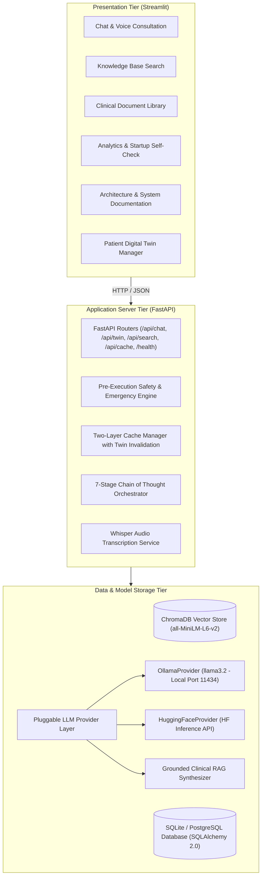

# High-Level Design (HLD): MedTwin AI

## 1. System Overview
MedTwin AI is an edge-first, open-source clinical RAG conversational assistant. It provides a modular, multi-tier architecture designed for high maintainability, strict clinical boundary enforcement, pluggable LLM backends (Ollama & Hugging Face), and deterministic performance.

---

## 2. Component Deconstruction

### 2.1 Presentation Tier (Streamlit)
- **Framework**: Streamlit with custom CSS tokens, dark mode styling, and `toolbarMode = "viewer"`.
- **Twin Manager Sidebar**: Allows interactive customization and 1-click loading of validated patient clinical profiles (Alex Morgan, Elena Rostova, Marcus Vance).
- **5 Core Workspaces**:
  1. **Chat & Voice**: Real-time consultation, collapsible 7-stage CoT reasoning panel, citation cards, Whisper mic recording (visible by default with auto-submit), HTML5 TTS audio read-aloud.
  2. **Knowledge Search**: Direct semantic search against ChromaDB with confidence scores.
  3. **Library**: Catalog of 8 official clinical guidelines with "Run Ingestion" button.
  4. **Analytics**: Real-time cache telemetry, hit/miss metrics, latency comparisons (cached vs fresh), startup self-check diagnostics, and recent query logs.
  5. **Docs**: Embedded Mermaid diagrams, data flow models, README overview, and technology evaluations.

### 2.2 Application Tier (FastAPI)
- **ASGI Server**: Uvicorn with asynchronous endpoints.
- **Pydantic Validation**: Strict schema enforcement for queries, twin profiles, and responses.
- **Dependency Injection**: Modular provision of database sessions, cache instances, voice services, and RAG pipelines.
- **Two-Layer Cache Engine**:
  - *Layer 1*: Exact SHA-256 hash match on `(patient_id + twin_hash + normalized_query)` (0ms).
  - *Layer 2*: Semantic vector similarity on embeddings with cosine threshold >= 0.92 within the same patient context.
  - *Twin Invalidation*: Saving or updating a profile increments `twin_version` and invalidates that patient's cache.
- **7-Stage CoT Pipeline**:
  - Stage 1: Intent Classification
  - Stage 2: Emergency / Red-Flag Detection (112, 108, 911, and twin conditions for responders)
  - Stage 3: Digital Twin Profile Injection
  - Stage 4: ChromaDB Vector Retrieval & Citation Scoring
  - Stage 5: Deterministic Safety Rules (NSAID vs Lisinopril/Metformin/Asthma)
  - Stage 6: Grounded LLM Answer Synthesis (Ollama -> HF -> Grounded Fallback)
  - Stage 7: Disclaimer & Clinical Post-Processing (softened language, balanced markdown, single disclaimer)

### 2.3 Data & Model Storage Tier
- **ChromaDB**: Embedded persistent vector store utilizing `hnsw:space: cosine` indexing.
- **Sentence-Transformers**: `all-MiniLM-L6-v2` generating 384-dimensional dense embeddings in <15ms.
- **SQLite / PostgreSQL Database**: ACID persistence across 6 normalized tables (`user_profiles`, `conversations`, `chat_messages`, `documents`, `cache_entries`, `query_logs`).
- **Pluggable LLM Provider Layer**:
  - `OllamaProvider`: Local edge inference via Ollama HTTP API with default model `llama3.2`.
  - `HuggingFaceProvider`: Cloud inference via `httpx` to the Hugging Face Inference API (`meta-llama/Llama-3.2-3B-Instruct`), supporting Streamlit Cloud deployments.
  - `Grounded Clinical Synthesizer`: Offline RAG generator ensuring guaranteed educational answers if LLMs are offline.
