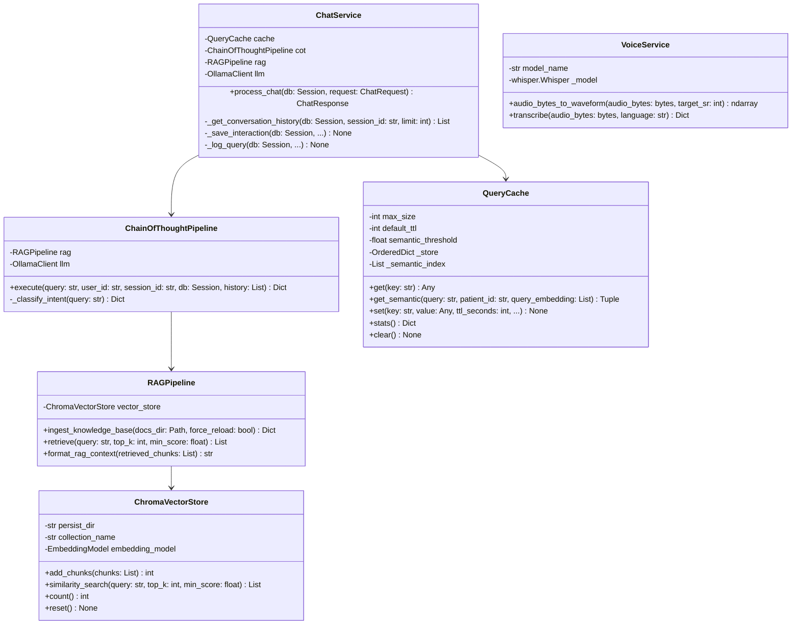

# Low-Level Design (LLD): MedTwin AI

## 1. Class Structure & Module Decomposition

---

## 2. Detailed Method Specifications

### 2.1 `ChatService.process_chat(db: Session, request: ChatRequest) -> ChatResponse`
1. Validates input bounds (`user_id`, `session_id`, `len(message) <= 3000`).
2. Runs immediate pre-execution emergency keyword detection via `detect_emergency(raw_message)`. If triggered, returns urgent 911/112 notification and bypasses LLM inference.
3. Retrieves patient digital twin context from SQLite via `get_profile(db, user_id)`.
4. Computes deterministic 64-character SHA-256 cache key using `generate_cache_key(user_id, raw_message, profile_dict)`.
5. Queries Layer 1 (Exact Match). If hit, records telemetry and returns in <2ms.
6. Queries Layer 2 (Semantic Match) with cosine similarity threshold ~0.92 within the same patient context.
7. On cache miss, delegates to `ChainOfThoughtPipeline.execute(...)`.
8. Persists chat turn in SQLite `chat_messages` table and telemetry in `query_logs` table.
9. Caches response in Layer 1 and indexes for Layer 2.

### 2.2 `ChainOfThoughtPipeline.execute(...)`
- **Stage 1 (Intent)**: Maps clinical inquiry into one of 6 categories.
- **Stage 2 (Emergency)**: Verifies absence of acute red-flag symptoms.
- **Stage 3 (Twin Context)**: Injects demographics, chronic conditions, and medications.
- **Stage 4 (Retrieval)**: Executes ChromaDB semantic search and extracts top-k chunks.
- **Stage 5 (Deterministic Safety)**: Checks drug-drug interactions:
  - *NSAID vs ACE Inhibitors*: Constriction of afferent + dilation of efferent arterioles -> Acute Kidney Injury (AKI) risk.
  - *NSAID vs Metformin*: Renal clearance reduction -> Lactic acidosis risk.
  - *NSAID vs Asthma*: Leukotriene shunting -> Severe bronchospasm (AERD).
- **Stage 6 (LLM Synthesis)**: Assembles grounded prompt with strict bracket citations `[source.md]` and invokes Ollama.
- **Stage 7 (Post-Processing)**: Softens diagnostic assertions and appends mandatory medical disclaimer.

### 2.3 `QueryCache` (Two-Layer Implementation)
- **Layer 1 Store**: `OrderedDict[str, CacheEntry]` keyed by 64-char SHA-256 hash.
- **Layer 2 Store**: `List[Dict[str, Any]]` containing patient ID, 384-dimensional dense vector embeddings, and cache keys.
- **LRU Eviction**: When `len(_store) >= max_size`, invokes `popitem(last=False)` to prune the least recently accessed item.
- **TTL Purge**: Checks `time.time() > entry.expires_at` on every lookup and periodically sweeps expired entries.
