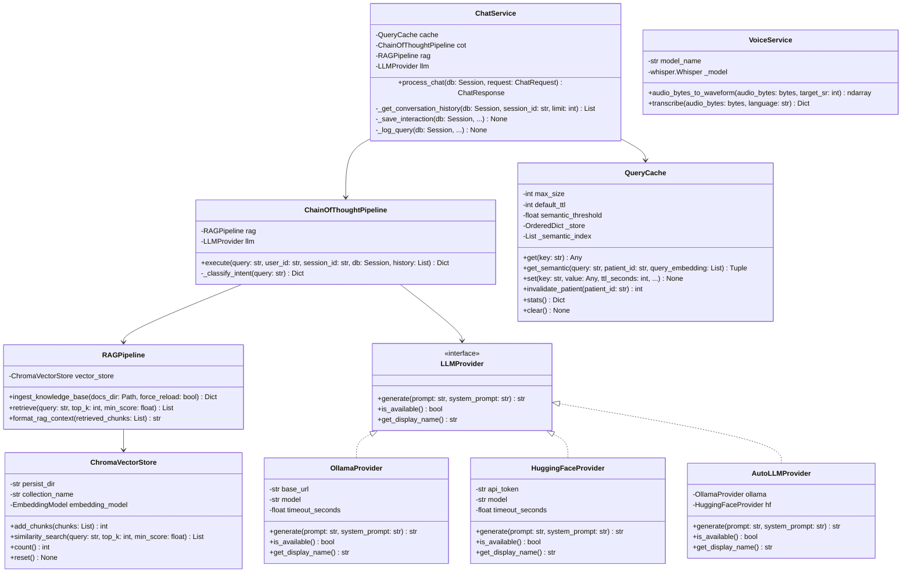

# Low-Level Design (LLD): MedTwin AI

## 1. Class Structure & Module Decomposition

---

## 2. Detailed Method Specifications

### 2.1 `ChatService.process_chat(db: Session, request: ChatRequest) -> ChatResponse`
1. Validates input bounds (`user_id`, `session_id`, `len(message) <= 3000`).
2. Runs immediate pre-execution emergency keyword detection via `check_emergency_keywords(raw_message)`. If triggered, returns urgent notification (112, 108, 911), injects twin conditions for responders, logs to `query_logs`, and **bypasses LLM and RAG inference entirely**.
3. Retrieves patient digital twin context from SQLite via `get_profile(db, user_id)` and generates `twin_hash`.
4. Computes deterministic 64-character SHA-256 cache key using `generate_cache_key(user_id, raw_message, profile_dict)`.
5. Queries Layer 1 (Exact Match). If hit, records telemetry and returns in 0ms (`⚡ Cached EXACT`).
6. Queries Layer 2 (Semantic Match) with cosine similarity threshold >= 0.92 within the same patient context.
7. On cache miss, delegates to `ChainOfThoughtPipeline.execute(...)`.
8. Persists chat turn in SQLite `chat_messages` table and telemetry in `query_logs` table.
9. Caches non-emergency responses in Layer 1 and indexes for Layer 2.

### 2.2 `LLMProvider` Interface & Implementations
- **`OllamaProvider`**: Connects via `httpx.AsyncClient` to local Ollama daemon (`http://localhost:11434/api/generate`) with model `llama3.2`.
- **`HuggingFaceProvider`**: Connects via `httpx.AsyncClient` to Hugging Face Inference API (`https://api-inference.huggingface.co/models/{HF_MODEL}`) with bearer token authentication (`HF_API_TOKEN`). Handles HTTP 503 model-loading retries.
- **`AutoLLMProvider`**: Orchestrates fallback chain: checks Ollama availability first; if unreachable, attempts Hugging Face; if both fail, raises an honest error allowing the grounded synthesizer to produce evidence-backed retrieval excerpts.

### 2.3 `ChainOfThoughtPipeline.execute(...)`
- **Stage 1 (Intent)**: Maps clinical inquiry into one of 6 categories.
- **Stage 2 (Emergency)**: Verifies absence of acute red-flag symptoms.
- **Stage 3 (Twin Context)**: Injects demographics, chronic conditions, and medications.
- **Stage 4 (Retrieval)**: Executes ChromaDB semantic search and extracts top-k chunks with confidence scores.
- **Stage 5 (Deterministic Safety)**: Evaluates drug-drug interactions (NSAIDs vs Lisinopril, Metformin, Asthma) and checks deterministic allergy conflicts.
- **Stage 6 (LLM Synthesis)**: Assembles grounded prompt and invokes active `LLMProvider` (or Grounded RAG synthesizer if offline).
- **Stage 7 (Post-Processing)**: Softens diagnostic assertions ("can increase the risk"), balances markdown, adds allergy check line, and guarantees a single medical disclaimer.

### 2.4 `QueryCache` (Two-Layer Implementation)
- **Layer 1 Store**: `OrderedDict[str, CacheEntry]` keyed by 64-char SHA-256 hash containing patient ID and twin version hash.
- **Layer 2 Store**: `List[Dict[str, Any]]` containing patient ID, 384-dimensional dense vector embeddings, and cache keys.
- **Patient Invalidation**: `invalidate_patient(patient_id)` purges all cached entries for a given patient when their digital twin is updated.
- **LRU Eviction**: When `len(_store) >= max_size`, invokes `popitem(last=False)` to prune the least recently accessed item.
- **TTL Purge**: Checks `time.time() > entry.expires_at` on every lookup and periodically sweeps expired entries.
