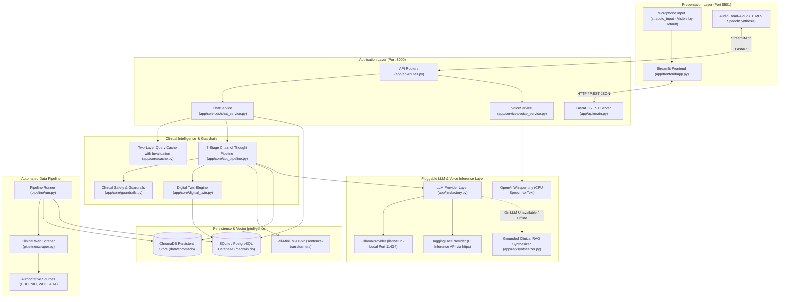

# Architecture Diagram: MedTwin AI

## 1. System Architecture Diagram

---

## 2. Design Principles
1. **Edge-First & Pluggable Cloud Hybrid**: Operates 100% offline via local Ollama (`llama3.2`) or seamlessly deploys to cloud platforms (Streamlit Cloud) via the Hugging Face Inference API.
2. **Deterministic Safety Over Speculation**: Red-flag symptoms and drug contraindications are intercepted by deterministic rule engines with configurable numbers (112, 108, 911), eliminating LLM jailbreak vulnerabilities.
3. **Traceable Reasoning**: Each step of the 7-stage CoT pipeline is recorded and exposed to the user in a collapsible panel for clinical auditability.
4. **Context Isolation**: Multi-patient cache isolation keys bind the patient ID and twin version, preventing PHI leakage and immediately invalidating stale cache on profile saves.
