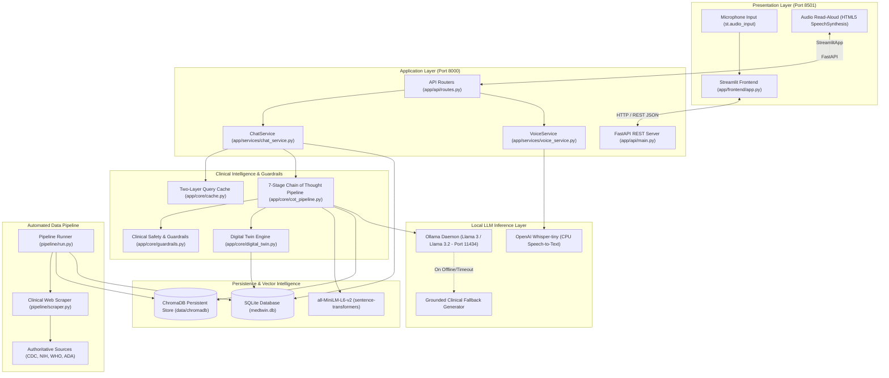

# Architecture Diagram: MedTwin AI

## 1. System Architecture Diagram

---

## 2. Design Principles
1. **Edge-First & Fully Local**: No cloud API keys or SaaS dependencies required. Operates on standard workstation hardware.
2. **Deterministic Safety Over Speculation**: Red-flag symptoms and drug contraindications are intercepted by deterministic rule engines, eliminating LLM prompt-jailbreak vulnerability.
3. **Traceable Reasoning**: Each step of the 7-stage CoT pipeline is recorded and exposed to the user in a collapsible panel for clinical auditability.
4. **Context Isolation**: Multi-patient cache isolation prevents PHI leakage across consultation threads.
