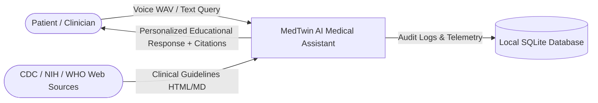
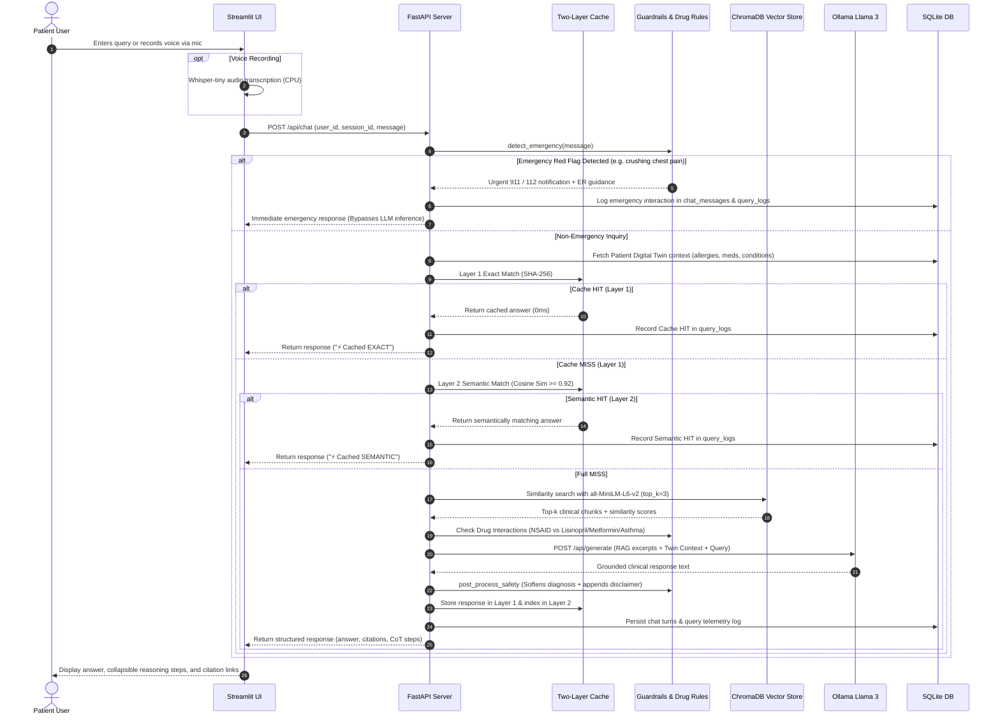

# Data Flow Diagram (DFD): MedTwin AI

## 1. Level-0 Context DFD
The Level-0 Context Diagram illustrates the interaction between external users and the MedTwin AI system boundaries.

---

## 2. Level-1 Detailed Data Flow Diagram
The Level-1 DFD captures internal data transformations through each processing stage:

