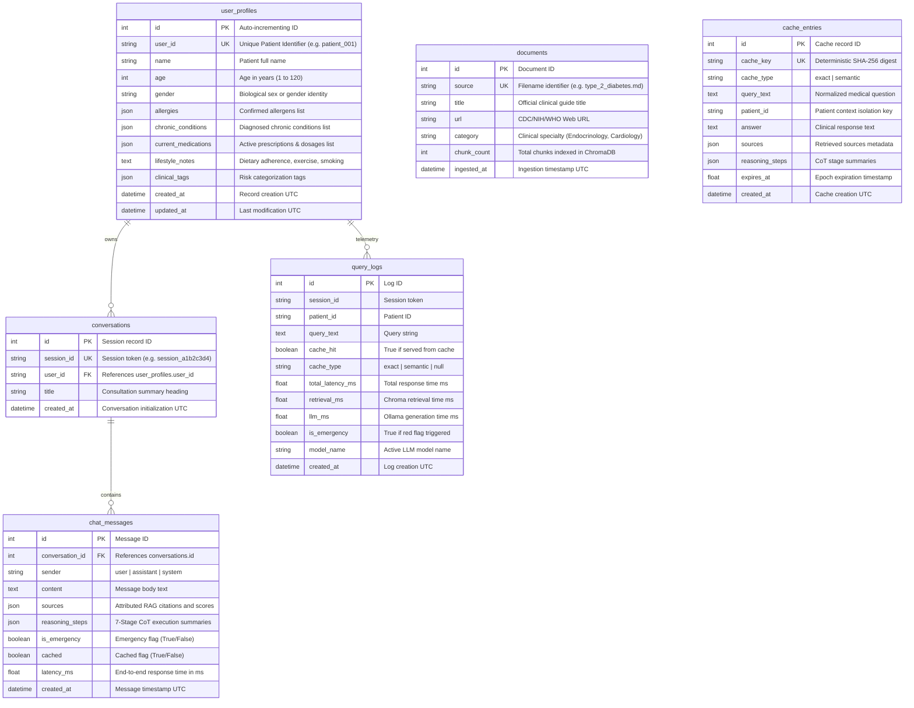

# Database Design (ER): MedTwin AI

## 1. Relational Database Overview
MedTwin AI utilizes **SQLite** orchestrated through **SQLAlchemy 2.0 ORM**. SQLite provides embedded, zero-configuration ACID persistence without external server dependencies, guaranteeing 100% local operation and clinical privacy.

---

## 2. Table Schemas & Indexing Strategy

### 2.1 Table: `user_profiles`
- **Primary Key**: `id` (INTEGER, AUTOINCREMENT)
- **Unique Index**: `user_id` (VARCHAR(64), UNIQUE)
- **Clinical Privacy**: Background medical history stored in structured JSON columns (`allergies`, `chronic_conditions`, `current_medications`).

### 2.2 Table: `conversations`
- **Primary Key**: `id` (INTEGER, AUTOINCREMENT)
- **Unique Index**: `session_id` (VARCHAR(64), UNIQUE)
- **Foreign Key**: `user_id` -> `user_profiles.user_id` with `ON DELETE CASCADE`.

### 2.3 Table: `chat_messages`
- **Primary Key**: `id` (INTEGER, AUTOINCREMENT)
- **Foreign Key**: `conversation_id` -> `conversations.id` with `ON DELETE CASCADE`.
- **JSON Metadata**: `sources` and `reasoning_steps` stored as structured JSON arrays.

### 2.4 Table: `documents`
- **Primary Key**: `id` (INTEGER, AUTOINCREMENT)
- **Unique Index**: `source` (VARCHAR(255), UNIQUE)
- **Audit Columns**: `url`, `category`, `chunk_count`, `ingested_at`.

### 2.5 Table: `query_logs`
- **Primary Key**: `id` (INTEGER, AUTOINCREMENT)
- **Indexes**: `session_id`, `patient_id` for fast telemetry filtering.
- **Metrics**: `total_latency_ms`, `retrieval_ms`, `llm_ms`, `cache_hit`, `is_emergency`.
