# Plan of Action & Engineering Timeline: MedTwin AI

## 1. 20-Hour Implementation Timeline

```mermaid
gantt
    title MedTwin AI 20-Hour Engineering Timeline
    dateFormat  HH:mm
    axisFormat %H:%M

    section Phase 1: Foundations & Architecture
    Architecture, Requirements & LLM Provider Interface (Hours 0-2) :done, p1, 00:00, 2h
    Authoritative Data Pipeline & ChromaDB Ingestion (Hours 2-4)     :done, p2, 02:00, 2h

    section Phase 2: Core Clinical Intelligence
    7-Stage CoT Reasoning & Grounded RAG (Hours 4-7)               :done, p3, 04:00, 3h
    Clinical Safety, Drug Engine & Emergency Protocol (Hours 7-10)  :done, p4, 07:00, 3h
    Multi-Provider LLM Layer (Ollama & HuggingFace) (Hours 10-12)   :done, p5, 10:00, 2h

    section Phase 3: Performance, Privacy & Voice
    Two-Layer Cache Engine with Twin Invalidation (Hours 12-14)    :done, p6, 12:00, 2h
    Whisper Voice Ingestion & Speech Synthesis (Hours 14-16)        :done, p7, 14:00, 2h

    section Phase 4: UI, Deployment & Verification
    Streamlit 5-Tab UI, Self-Check & Cloud Config (Hours 16-18)     :done, p8, 16:00, 2h
    121+ Test Suite, Coverage & Full Docs Audit (Hours 18-20)       :done, p9, 18:00, 2h
```

### Detailed Breakdown

#### Hours 0–2: Architecture, Requirements & Pluggable Provider Interface
- Mapped all requirements of Problem Statement 2 (RAG, Digital Twin, Voice, CoT, open-source models, caching, DB, safety, tests, docs).
- Designed the `LLMProvider` abstract base class with `OllamaProvider`, `HuggingFaceProvider`, and `AutoLLMProvider` fallback chain.
- Configured Python 3.12 virtual environment, pytest configuration, and dependencies.

#### Hours 2–4: Authoritative Clinical Data Pipeline & ChromaDB
- Built `pipeline/scraper.py` using BeautifulSoup for authoritative medical guidelines (CDC, NIH, WHO, ADA).
- Ingested 8 comprehensive medical guidelines covering Diabetes, Hypertension, NSAID safety, Heart Attack emergencies, and DASH diet.
- Configured `sentence-transformers/all-MiniLM-L6-v2` dense embedding model (384 dimensions) and persistent ChromaDB collection.

#### Hours 4–7: 7-Stage Chain of Thought (CoT) & Grounded Synthesis
- Engineered `app/core/cot_pipeline.py` executing 7 explicit stages as code:
  1. Intent Classification
  2. Red-Flag & Emergency Detection
  3. Digital Twin Context Injection
  4. Knowledge Base Retrieval & Scoring
  5. Deterministic Safety & Drug Interaction Checks
  6. Structured LLM Generation (with offline Grounded RAG fallback)
  7. Disclaimer & Clinical Post-Processing
- Integrated structured reasoning steps summary output and citation mapping.

#### Hours 7–10: Clinical Safety, Drug Interaction Engine & Emergency Protocol
- Implemented configurable emergency hotlines (112, 108 in India; 911 in US/Canada).
- Isolated the 988 Suicide & Crisis Lifeline strictly to self-harm queries (never for chest pain).
- Injected Digital Twin conditions and current medications for first responders.
- Softened clinical interaction alerts ("can increase the risk") and added mandatory allergy check lines.

#### Hours 10–12: Multi-Provider LLM Layer (Ollama & Hugging Face)
- Implemented `OllamaProvider` connecting to local `llama3.2` instances via `/api/generate`.
- Implemented `HuggingFaceProvider` connecting via `httpx` to Hugging Face Inference API for Streamlit Cloud deployment.
- Enforced honest retrieval-only excerpts if all LLM backends are unreachable (no fake templates).

#### Hours 12–14: Two-Layer Cache Engine with Twin Invalidation
- Engineered Layer 1 exact match (deterministic 64-char SHA-256) with strict patient isolation keys.
- Engineered Layer 2 semantic vector similarity (cosine threshold >= 0.92).
- Built automatic cache invalidation upon saving/updating digital twin profiles.
- Added LRU eviction and TTL expiration with full query logging in SQLite.

#### Hours 14–16: Whisper Voice & Audio Playback
- Optimized `VoiceService` with OpenAI Whisper-tiny CPU inference.
- Implemented in-memory audio resampling for arbitrary WAV/PCM formats to 16kHz mono.
- Made voice input visible by default with automatic submission upon speech completion.
- Rendered full-text Read Aloud TTS button via HTML5 Web Speech Synthesis.

#### Hours 16–18: Streamlit 5-Tab UI & Cloud Deployment Config
- Streamlined UI into 5 shortened tabs: "Chat & Voice", "Knowledge Search", "Library", "Analytics", "Docs".
- Added startup self-check diagnostics on the Analytics tab (LLM provider, Chroma chunks, DB connection, Whisper model).
- Configured `.streamlit/config.toml` (`[client] toolbarMode = "viewer"`) to hide deployment menus.

#### Hours 18–20: Testing, Code Coverage & Comprehensive Documentation
- Built and verified 121+ automated pytest unit and integration tests (100% passing).
- Achieved high test coverage with `pytest-cov`.
- Authored full documentation suite: Requirements, HLD, LLD, DFD, DB Design, Architecture, Libraries, Plan of Action, and README.

---

## 2. What I Am Confident About

1. **Safety & Emergency Boundary Enforcement**: 100% deterministic interception of life-threatening emergencies (e.g. crushing chest pain, dyspnea, stroke, self-harm) bypassing generative LLMs entirely and briefing responders with patient conditions.
2. **Deterministic Drug Contraindication Engine**: Hardcoded clinical rules catching dangerous interactions (Ibuprofen with Lisinopril or Metformin) that statistical LLMs often overlook or hallucinate.
3. **Pluggable Multi-Provider Architecture**: Complete independence from proprietary platforms; runs 100% offline locally via Ollama or in the cloud on Streamlit Cloud via Hugging Face.
4. **Two-Layer Caching with Patient Isolation**: Zero cross-patient PHI leakage; identical repeated queries return verified responses in 0ms (`⚡ Cached`), and profile updates immediately invalidate stale entries.
5. **Code Quality & Test Rigor**: 121+ comprehensive automated tests covering every layer of the application with clean separation of concerns and high coverage.

---

## 3. What Is Out of Scope (Future Roadmap)

1. **Direct EHR / HL7 / FHIR Integration**: Live synchronization with hospital EHRs requires certified HIPAA-compliant gateways.
2. **Direct E-Prescribing (eRx)**: Automated transmission of prescription orders to pharmacies requires DEA and Surescripts compliance.
3. **Continuous IoT Vitals Streaming**: Bluetooth streaming from CGMs or wearable pulse oximeters.
